

  

<h1 align="center">JoPlay</h1>

  <b>A fast, modern player for your PS4 that works with Stremio add-ons.</b> 
  Title ID <code>JOST00001</code> · created by JVK3R 
  <i>Proudly created alongside AI by JVK3R</i>

  
  
  
  

  <a href="#install">Install</a> ·
  <a href="#using-it">Using it</a> ·
  <a href="#add-ons">Add-ons</a> ·
  <a href="#stremio-optional">Stremio</a> ·
  <a href="#mullvad-vpn-optional">Mullvad</a> ·
  <a href="#words-youll-see">Words you'll see</a> ·
  <a href="#support-joplay">Support</a>

> [!IMPORTANT]
> **All official communications are here on Discord or Twitter:**
> [Discord](https://discord.gg/w5dtAMBVgZ) · [Twitter / X (@jvk3r_)](https://x.com/jvk3r_)

> [!WARNING]
> **JoPlay comes with no content and links to none.** It plays what the add-ons you choose point to.
> Only use add-ons for content you have the right to watch.

  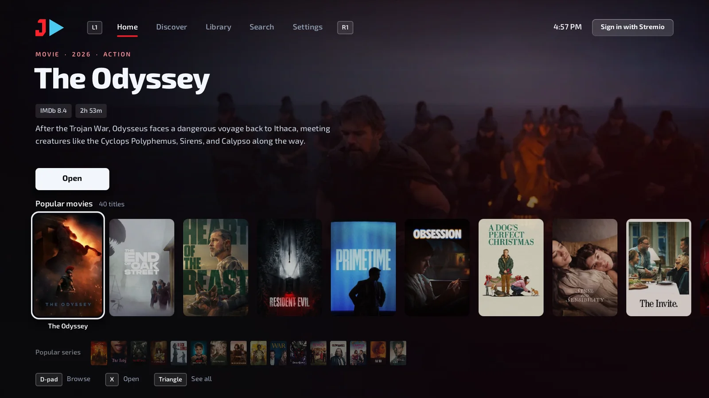 
  Stremio's own catalog (Cinemeta), built in. JoPlay shows titles and posters; it doesn't host or provide any film or show.

> [!TIP]
> **JoPlay is free and made by one person.** If you enjoy it, [support it on Ko-fi](https://ko-fi.com/jvk3r)
> or [with crypto](#support-joplay). Donations keep the servers running and the updates coming.

## What it is

JoPlay is an app for jailbroken PS4s. It looks and feels like a streaming app: you browse rows of movies and shows with posters, open one, pick a stream, and watch.

- **Home, Discover, Library and Search,** plus **See all** to open any row as a full grid.
- **Subtitles** (the film's own and your add-ons'), **sound tracks** and **chapters**. Blu-ray and DVD picture subtitles show as the disc draws them, and Arabic, Persian and Urdu read right to left with their letters joined.
- **The next episode** can start by itself, or wait for you.
- **In English or Arabic.** JoPlay starts in your PS4's language; Settings, Language changes it.
- **Easy updates:** JoPlay tells you when a new version is out and downloads it for you, then shows the three steps to install it.

<table>
  <tr>
    <td width="50%">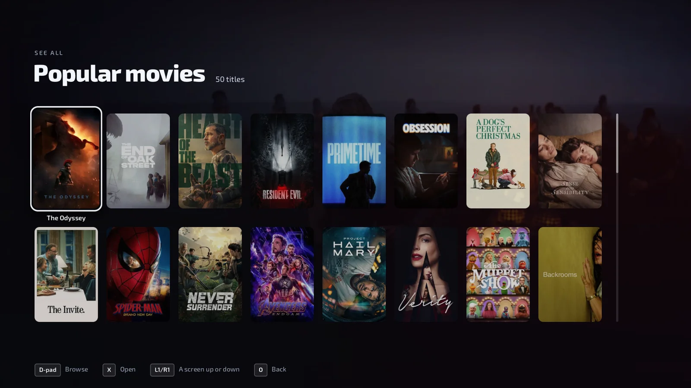</td>
    <td width="50%">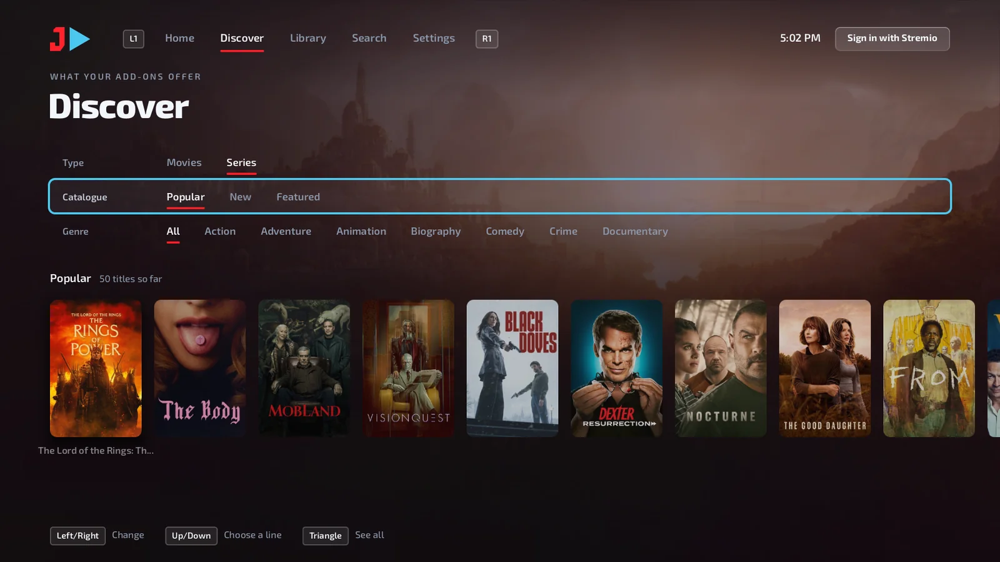</td>
  </tr>
  <tr>
    <td align="center"><b>See all</b> opens any row as a full grid</td>
    <td align="center"><b>Discover</b> browses each catalog by genre</td>
  </tr>
  <tr>
    <td width="50%">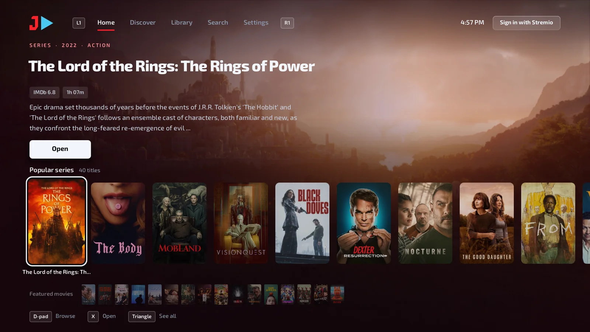</td>
    <td width="50%">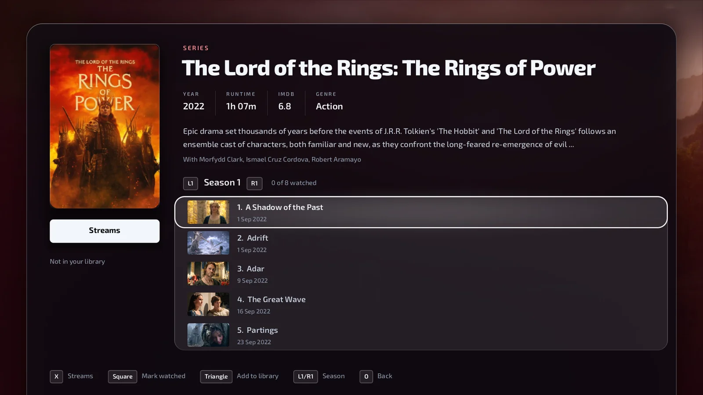</td>
  </tr>
  <tr>
    <td align="center"><b>Movies and series,</b> side by side</td>
    <td align="center"><b>Every season and episode,</b> with what you've watched</td>
  </tr>
</table>

JoPlay shows Stremio's catalog out of the box, but it doesn't come with anything to play. Streams come from **add-ons** you add yourself (see [Add-ons](#add-ons)). To try it right away, it has **Open Movies** built in: three short films the Blender Foundation made free for everyone.

## What you need

| | |
|---|---|
| **A jailbroken PS4** | Required. Any model: original, Slim or Pro, running [GoldHEN](#words-youll-see). |
| **Add-ons** | For anything past the built-in films. [How to add them](#add-ons). |
| **A Stremio account** | Optional and free. Keeps your add-ons, library and progress in one place. [More](#stremio-optional). |
| **A Mullvad account** | Optional and paid. Keeps what JoPlay does private. [More](#mullvad-vpn-optional). |

## Install

1. Download the `.pkg` file from [Releases](https://github.com/JVK3R/JoPlay/releases/latest).
2. Copy it to the top folder of a USB drive (formatted exFAT or FAT32) and plug the drive into your PS4.
   Or send it from your PC over the network ([FTP](#words-youll-see)) into `/data/pkg`.
3. Start GoldHEN, then go to **Settings > Debug Settings > Game > Package Installer** and pick JoPlay.
4. JoPlay is now on your home screen.

**Updating:** when a new version is out, JoPlay says so in **Settings**. Press Square there, then X, and it downloads the update for you. Then it shows three steps: close JoPlay, delete it from the home screen, and install the new one from the Package Installer. You won't lose anything: your sign-ins, add-ons and settings are kept in `/data/JoPlay`, and deleting the app doesn't touch that folder.

## Using it

<table>
  <tr>
    <td width="50%">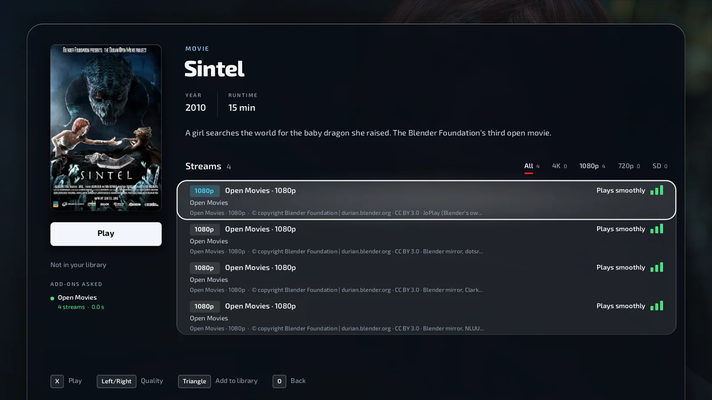</td>
    <td width="50%">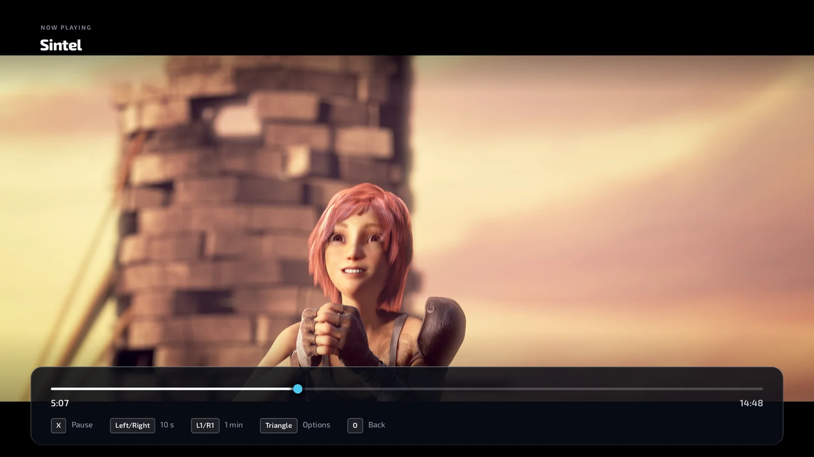</td>
  </tr>
</table>

| Button | Around the app | While watching |
|---|---|---|
| **L1 / R1** | Switch tabs | Back or ahead 1 minute |
| **Left / Right** | Move around | Back or ahead 10 seconds |
| **X** | Open, choose | Pause, play |
| **O** | Go back | Leave the film |
| **Triangle** | See all, more choices | Subtitles, sound and more |
| **Square** | Sort, remove | |

### Will it play smoothly?

The PS4 is an older console, so JoPlay labels every stream before you pick it. It judges each one by what its name says (resolution, video type, sound), so a stream with a vague name may play heavier than its label:

- **Plays smoothly:** regular 1080p or lower. Pick these.
- **May stutter:** heavier files (HEVC, 10-bit, Remux, or TrueHD and DTS-HD sound).
- **Won't play well:** too heavy for a PS4 (4K, HEVC 10-bit, 60 fps, AV1). JoPlay hides these at first. Press Square on the stream list to see them anyway.

## Add-ons

Add-ons are what JoPlay shows and plays. Each one is a small online service that gives JoPlay:

- **catalogs:** the rows of titles you browse, and
- **streams:** the actual video you play.

JoPlay works with the same add-ons as Stremio. You add one with its **link**, a web address that usually ends in `/manifest.json`.

**If you're signed in with Stremio,** add add-ons in Stremio on your phone or computer. JoPlay picks them up the next time it opens, or straight away if you press Triangle on **Settings > Add-ons**.

**If you're not signed in,** add them on the PS4. Your phone does the typing:

1. Go to **Settings > Add-ons > Add from your phone**.
2. Scan the code on the TV with your phone's camera.
3. Paste the add-on's link on the page that opens on your phone, and send it.
4. Check the add-on's name on the PS4 and press **X**.

Your phone and PS4 have to be on the same Wi-Fi. If the page won't open, use **Add by link** in the same menu to type the link on the PS4 instead.

<b>Show me the four steps</b>

 

| | |
|---|---|
|  | 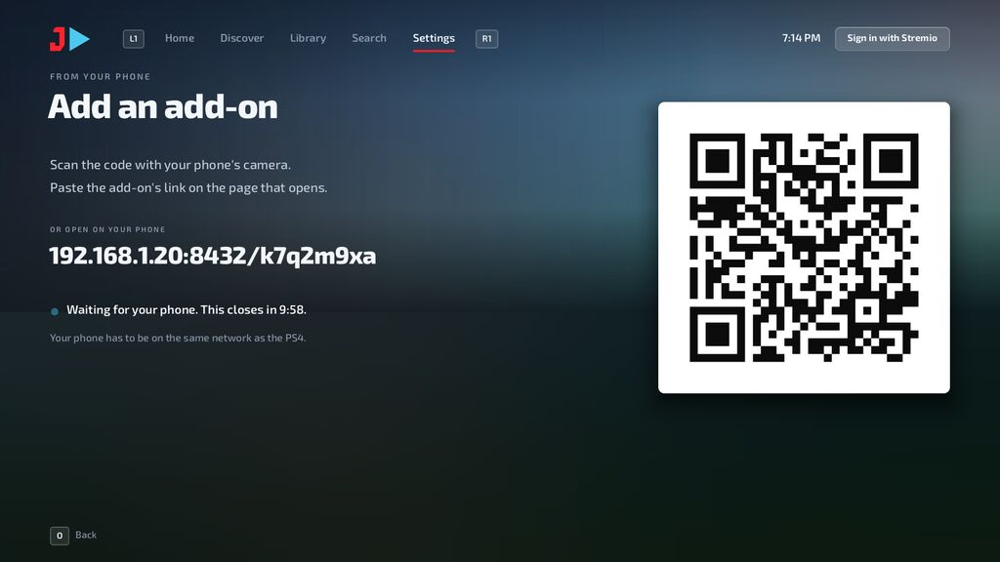 |
| 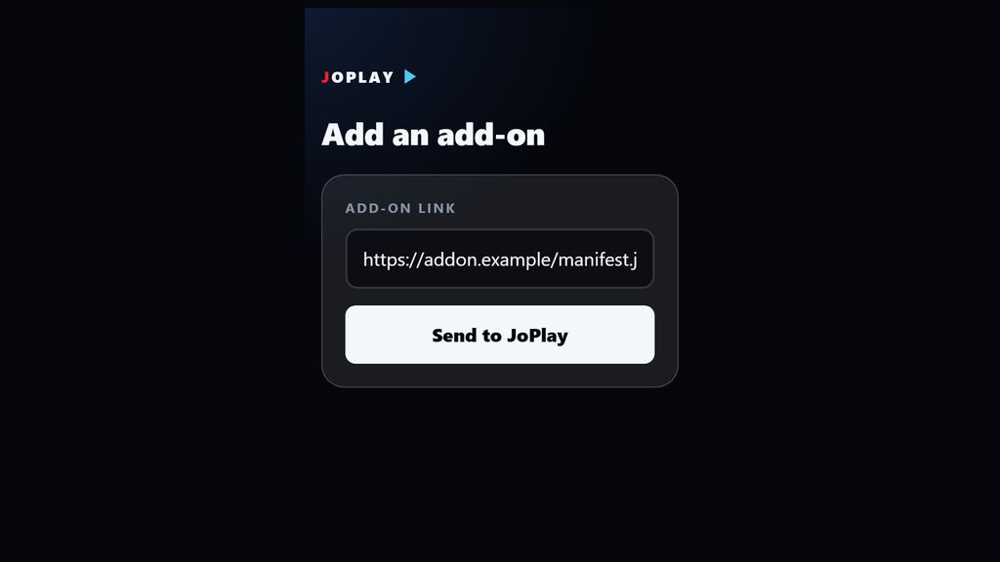 |  |

In **Settings > Add-ons** you can reorder your add-ons with X (Home shows their rows in that order) and remove one with Square. Some add-on links contain a private key, so JoPlay never shows or saves a full link where others could see it.

JoPlay doesn't suggest or list add-ons.

## Stremio (optional)

[Stremio](https://www.stremio.com) is a free streaming app for phones, computers and TVs, built around add-ons. A free Stremio account remembers your add-ons, your library and how far you got in everything you watch.

JoPlay isn't Stremio, but it can sign in to your Stremio account. When you do:

- Your add-ons, library and **Continue watching** show up on the PS4.
- What you watch on the PS4 shows up in Stremio on your other devices, and the other way round.

**To sign in,** press **Sign in with Stremio** (top right of Home, or in Settings), scan the code with your phone, and confirm. You never type your password on the PS4.

**No account?** That's fine. Everything works, and your add-ons, library and progress are kept on the PS4.

## Mullvad VPN (optional)

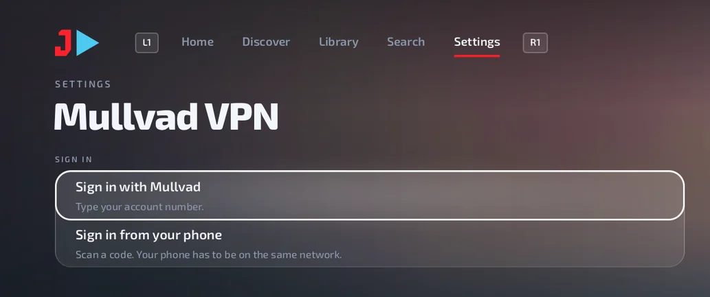

A **VPN** sends your internet traffic through another company's servers first. Your internet provider then can't see which sites you connect to, and those sites see the VPN's address instead of your home's.

[Mullvad](https://mullvad.net) is a paid VPN known for privacy: no email or name, just an account number. It's built into JoPlay:

- **Only JoPlay goes through Mullvad.** The rest of your PS4 (games, PSN) doesn't.
- **Nothing slips out.** If Mullvad is on but can't connect, JoPlay sends nothing until it can, or until you turn it off.
- **It counts as one device** on your Mullvad account. Mullvad allows 5.

**To turn it on,** go to **Settings > Mullvad VPN > Sign in with Mullvad**. Type your account number on the PS4 or from your phone, pick a location, and switch it on.

## Words you'll see

| Word | What it means |
|---|---|
| **Jailbroken PS4** | A PS4 that can run apps from outside the PlayStation Store. |
| **GoldHEN** | The tool that does that. You start it each time the PS4 turns on. |
| **Homebrew** | Apps made by people, not by Sony. JoPlay is one. |
| **.pkg** | An app's install file, like an app download on a phone. |
| **Package Installer** | Where the PS4 installs a `.pkg` from. It's under **Settings > Debug Settings > Game** once GoldHEN is running. |
| **FTP** | A way to send files from your PC to the PS4 over your home network. GoldHEN and apps like Itemzflow can turn it on. |
| **`/data`** | A folder on the PS4 where apps keep their own files. JoPlay's are in `/data/JoPlay`. |
| **Add-on** | A small online service that gives JoPlay its rows of titles and the video to play. |
| **Stream** | One way to watch a title. A film can have several, in different qualities. |
| **VPN** | A service that keeps what you do online private from your internet provider. |

## Good to know

- **Nothing to watch?** JoPlay plays what your add-ons find. Check **Settings > Add-ons**.
- **The phone page won't open?** Your phone and PS4 aren't on the same Wi-Fi. Guest Wi-Fi often keeps them apart. Use **Add by link** instead.
- **It stutters?** Pick a stream marked **Plays smoothly**.
- **Something went wrong?** Use **Settings > Report a problem**, then tell us about it on the [Discord](https://discord.gg/w5dtAMBVgZ).
- Made and tested on a PS4 on firmware 11.00 with GoldHEN.

<b>More screens</b>

 

| | |
|---|---|
| 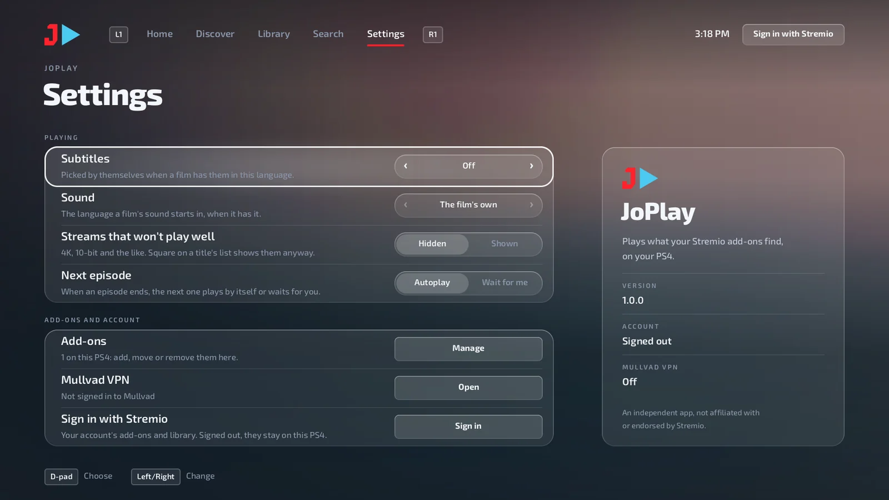 | 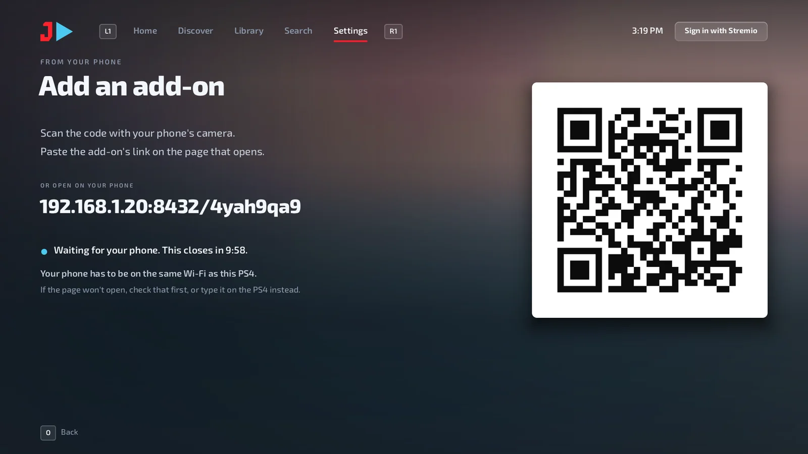 |
| 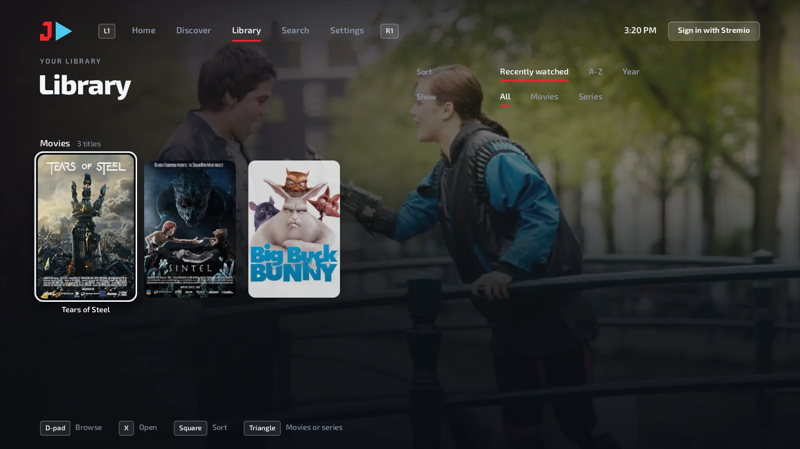 | 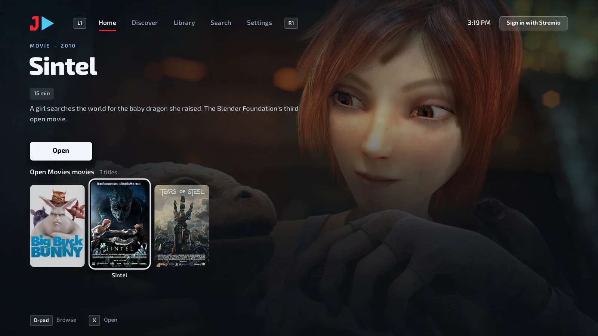 |

## What JoPlay sends

JoPlay sends anonymous usage counts so we can see how many people use it and fix what breaks:

- a random ID made on your PS4 (not tied to your PS4, your PSN or any account),
- the JoPlay version and the PS4's firmware,
- whether Mullvad and the Stremio sign-in are switched on,
- how long JoPlay is open and how many films or episodes are started.

**Never** what you watch, your add-ons, your accounts or your address. Turn it off any time in **Settings > Usage counts**.

**Report a problem** in Settings sends JoPlay's log to us. Before it leaves your PS4, everything personal is taken out: titles, add-ons, links, keys, accounts and addresses. If JoPlay crashes, it sends that log once by itself, cleaned the same way (only while usage counts are on).

## Support JoPlay

JoPlay is free, and it's made by one person. Donations pay for what keeps it running: the servers behind the updates and the built-in films, and the time each release takes. Nothing in the app is locked or held back. A donation is a thank-you, never a requirement, and it backs all of JVK3R's projects.

  

| How | Where |
| --- | --- |
| **Ko-fi** | [ko-fi.com/jvk3r](https://ko-fi.com/jvk3r): card, Apple Pay or Google Pay, once or monthly |
| **Bitcoin** | `3PeEqA8UTvCuLwR1K5NKP8k11dFAh14rqM` |
| **USDC on Solana** | `6iWHFuvmBgZtUsyF3GmrF2Ng4tAPnBaEJkD8tr7Hm3cX` |

Supporters are thanked by name on [jobees.org/#support](https://jobees.org/#support) (a private gift stays private) and get the Supporter role on [Discord](https://discord.gg/w5dtAMBVgZ). Gave in crypto? Open a ticket there with the transaction link.

## Credits

JoPlay is made by JVK3R on JoUI, our own engine. Closed source.

It uses FFmpeg (LGPL 2.1), libwebp, lwIP, Mbed TLS, Monocypher, BLAKE2, stb, Mozilla's list of trusted certificates and the Exo 2 font. Open Movies are Big Buck Bunny, Sintel and Tears of Steel, © Blender Foundation, CC BY 3.0. Full licences, FFmpeg's source and the files to relink JoPlay are covered in [THIRD-PARTY-NOTICES.md](THIRD-PARTY-NOTICES.md).

JoPlay is an independent app, not affiliated with or endorsed by Stremio, Mullvad or Sony. PS4 is a trademark of Sony Interactive Entertainment.
