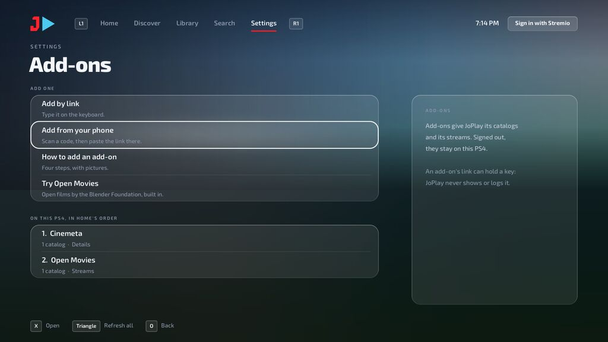
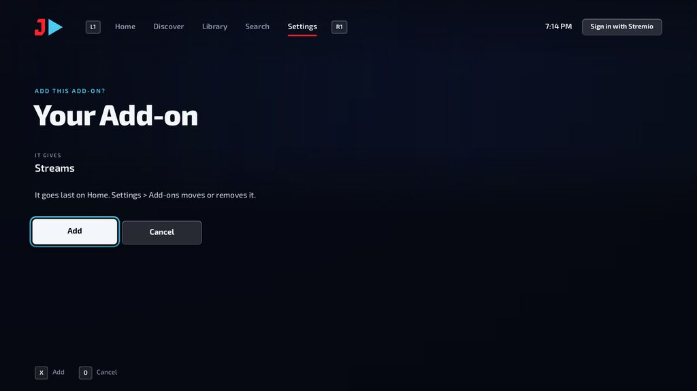

  

<h1 align="center">JoPlay</h1>

  A fast, modern player for your PS4 that works with Stremio add-ons. 
  <a href="../../releases/latest"><b>Download the latest .pkg</b></a> · <a href="https://discord.gg/w5dtAMBVgZ"><b>Discord</b></a>

---

## What it is

JoPlay is a homebrew app for jailbroken PS4s. You browse catalogs with posters and details, and JoPlay plays whatever your add-ons find.

- Home, Discover, Library and Search, plus **See all** to open any row as a full grid.
- Subtitles (the film's own and your add-ons'), sound tracks and chapters.
- The next episode can start by itself, or wait for you.

JoPlay has no streams of its own. It comes with two things built in so you can start right away: **Cinemeta**, Stremio's official catalog of titles, posters and episodes, and **Open Movies**, three open films by the Blender Foundation.

## What you need

| | |
|---|---|
| **A PS4 with GoldHEN** | Required. Any model: original, Slim or Pro. |
| **Add-ons** | Needed for anything past the built-in films. See [Add-ons](#add-ons). |
| **A Stremio account** | Optional and free. Brings your add-ons, library and progress. See [Stremio](#stremio-optional). |
| **A Mullvad account** | Optional and paid. Keeps JoPlay's traffic private. See [Mullvad](#mullvad-vpn-optional). |

## Install

1. Download the `.pkg` from [Releases](../../releases/latest).
2. Copy it to the top folder of a USB drive (exFAT or FAT32) and plug it into the PS4.
   Or send it by FTP to `/data/pkg`.
3. With GoldHEN running, open **Settings > Debug Settings > Game > Package Installer** and pick JoPlay.
4. Start JoPlay from the home screen.

**To update**, JoPlay tells you when a new version is out and downloads it for you. Then delete JoPlay from the home screen and install the new one from the Package Installer. Your sign-ins, add-ons and settings stay: they're kept in `/data/JoPlay`, which deleting the app doesn't touch.

## Controls

| Button | In the app | While playing |
|---|---|---|
| **L1 / R1** | Switch tabs | Back or ahead 1 minute |
| **Left / Right** | Move | Back or ahead 10 seconds |
| **X** | Open, choose | Pause, play |
| **O** | Back | Leave the film |
| **Triangle** | See all, more choices | Subtitles, sound and more |
| **Square** | Sort, remove | |

### Will it play smoothly?

JoPlay plays video on the PS4's own processor, so every stream gets a label before you pick it:

- **Should play smooth:** 1080p and below. Pick these.
- **May stutter:** HEVC, 10-bit, Remux, or TrueHD and DTS-HD sound.
- **Won't play well:** 4K, HEVC 10-bit, 60 fps, AV1. These are hidden at first. Square on the stream list shows them.

## Add-ons

Add-ons are small online services. They give JoPlay its catalogs (the rows of titles) and its streams (what it plays). JoPlay uses the same add-ons as Stremio. Each add-on has a link, usually ending in `/manifest.json`.

**Signed in with Stremio?** Add them in Stremio on your phone or computer. JoPlay shows your account's add-ons the next time it opens, or at once if you press Triangle on **Settings > Add-ons**.

**Not signed in?** Add them on the PS4, with your phone doing the typing:

1. **Settings > Add-ons > Add from your phone**
2. Scan the code with your phone's camera.
3. Paste the add-on's link on the page that opens and send it.
4. Check the add-on's name on the PS4 and press **X**.

Your phone has to be on the same network as the PS4. **Add by link** in the same menu lets you type the link on the PS4 instead.

<b>See the four steps</b>

 

| | |
|---|---|
|  |  |
|  |  |

In **Settings > Add-ons**, X moves an add-on (Home shows their rows in that order) and Square removes it. Some add-on links hold a private key, so JoPlay never shows or logs a full link.

JoPlay doesn't suggest or list add-ons. Only use add-ons for content you have the right to watch.

## Stremio (optional)

[Stremio](https://www.stremio.com) is a free media app for phones, computers and TVs, built around add-ons. A free Stremio account keeps your add-ons, library and progress in one place.

JoPlay is not Stremio, but it can sign in to your Stremio account:

- Your add-ons, library and Continue watching show up on the PS4.
- What you watch on the PS4 syncs back to Stremio on your other devices.

**To sign in**, press **Sign in with Stremio** (top right of Home, or in Settings), scan the code with your phone, and confirm. You never type your password on the PS4.

**No account?** Everything still works. Your add-ons, library and progress are kept on the PS4.

## Mullvad VPN (optional)

[Mullvad](https://mullvad.net) is a paid VPN known for privacy: no email or name, just an account number. A VPN sends your traffic through its own servers, so your internet provider can't see where it goes, and the sites you connect to don't see your home address.

Mullvad is built into JoPlay:

- Only JoPlay's traffic goes through Mullvad (catalogs, streams, sign-ins). The rest of the PS4 doesn't.
- If Mullvad is on but can't connect, JoPlay sends nothing until it can or you turn it off.
- JoPlay counts as one of your account's devices (Mullvad allows 5).

**To turn it on**, open **Settings > Mullvad VPN > Sign in with Mullvad**. Type your account number on the PS4 or from your phone, pick a location, and switch it on.

## Good to know

- **Nothing to watch?** JoPlay plays what your add-ons find. Check **Settings > Add-ons**.
- **The phone page won't open?** Your phone and PS4 aren't on the same network. Guest Wi-Fi often keeps them apart. Use **Add by link** instead.
- **It stutters?** Pick a stream marked **Should play smooth**.
- **Your files** are in `/data/JoPlay` on the PS4. If something goes wrong, `app.log` there tells us what happened.
- Made and tested on PS4 firmware 11.00 with GoldHEN.

## Help

Ask in the [Discord](https://discord.gg/w5dtAMBVgZ). For a bug, say what you did and attach `app.log`.

## Credits

JoPlay is made by JVK3R on JoUI, our own engine. Closed source.

It uses FFmpeg (LGPL 2.1), libwebp, lwIP, Mbed TLS, Monocypher, BLAKE2, Mozilla's list of trusted certificates and the Exo 2 font. Open Movies are Big Buck Bunny, Sintel and Tears of Steel, © Blender Foundation, CC BY 3.0. Full licences and FFmpeg's source are in [THIRD-PARTY-NOTICES.md](THIRD-PARTY-NOTICES.md).

JoPlay is an independent app, not affiliated with or endorsed by Stremio, Mullvad or Sony. It comes with no content and links to none: it plays what the add-ons you choose point to. PS4 is a trademark of Sony Interactive Entertainment.
